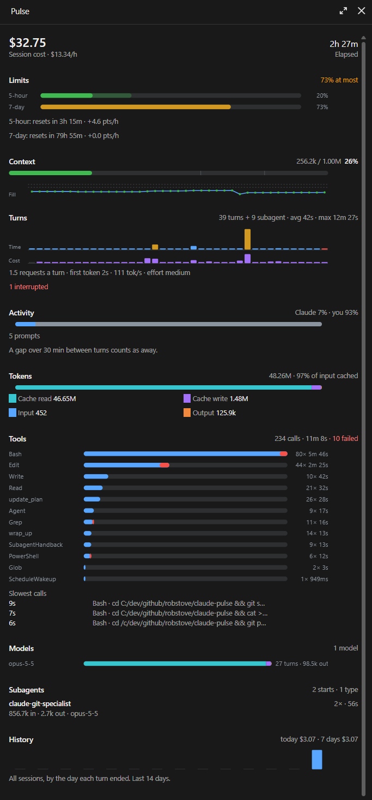

# Pulse

Live session metrics for Claude Code. Pulse tracks each session with hooks and shows the figures in a pane beside the chat and on the hint line under the prompt.



- **Cost and elapsed time** for the session, as the status line counts them, with the cost per hour.
- **Limits**: the 5-hour and 7-day rate-limit windows on a subscription, when each resets, the pace this session uses them at, and a red warning when that pace fills a window before it resets.
- **Context** fill as a gauge that turns amber at 60% and red at 80%, a line of the fill after each turn, and a mark at each compaction.
- **Turns**: time and cost per turn on one chart, with a live bar that grows once a second while a turn runs. Under it: model requests per turn, time to the first token, output tokens per second, effort, server tools such as web search, replies cut at the output limit, and turns that were interrupted or failed.
- **Activity**: how the active time splits between Claude at work and you between turns, with your prompt and slash-command counts.
- **Tokens**: cache read, cache write, input, and output as one stacked bar.
- **Tools**: total time per tool, with failed calls in red and the p50 and p95 time on hover, plus the three slowest calls. Calls that other plugins make through the tool chain are counted apart.
- **Files**: the files that Edit, Write, MultiEdit, and NotebookEdit changed, most edited first.
- **Models**: turns, average time, and tokens for each model that answered, so a `/model` switch shows its own share.
- **Subagents**: starts, time, tokens, and model for each subagent type.
- **History**: cost per day for the last 14 days across all sessions, with today and 7-day totals.

On desktop, VS Code, and mobile the charts are SVG with hover tooltips. The terminal gets block-character bars and sparklines.

## Install

At the prompt of a terminal session:

```
/plugin install pulse --marketplace robstove/claude-pulse
```

From a shell:

```bash
claude plugin install pulse --marketplace robstove/claude-pulse
```

In the desktop app, where `/plugin` does not run: click + next to the prompt box, then Plugins, Add marketplace with `robstove/claude-pulse`, then Add plugin.

This repository is private. It installs only for people who can read it on GitHub and whose machine already holds a git credential for github.com (an SSH key, or `gh auth login` then `gh auth setup-git`).

## Use

The pane opens when a session starts. If you close it, `/pulse` opens it again.

Counts start when the plugin first loads in a session. Cost, elapsed time, context, and rate limits come from the engine and cover the whole session.

The cost is the engine's own ledger, the same total that `/cost` and the status line show. The engine prices each API response in the session, subagents and compaction included, from its token counts at the model's list price, or at your organization's managed pricing when one is set. On a subscription it is an estimate at API rates, not a bill. Pulse gets the cost of a turn from the change in that total across the turn. The pace of a rate-limit window shows after 10 minutes of readings in the session.

Pulse saves each session's metrics in its plugin store at the end of every turn, so a restart or `claude --resume` reopens the pane with the session's history. It keeps the 50 most recent sessions. `/clear` starts a new session, and the pane starts empty.

## Develop

```bash
claude plugin validate .
claude plugin test .
```
