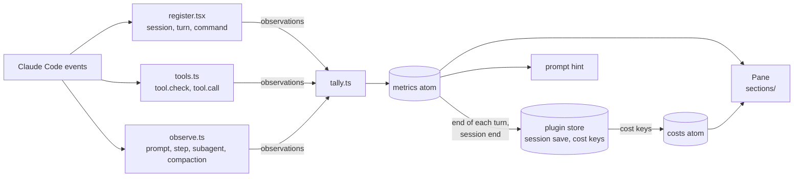

# Pulse


Live session metrics for Claude Code. Pulse tracks each session with hooks and shows the figures in a pane beside the chat and on the hint line under the prompt.

- **Cost and elapsed time** for the session, as the status line counts them, with the cost per hour.
- **Limits**: the 5-hour and 7-day rate-limit windows on a subscription, when each resets, the pace this session uses them at, and a red warning when that pace fills a window before it resets.
- **Context** fill as a gauge that turns amber at 60% and red at 80%, a line of the fill after each turn, and a mark at each compaction.
- **Turns**: time and cost per turn on one chart, with a live bar while a turn runs. Under it: model requests per turn, time to the first token, output tokens per second, effort, server tools, cut replies, and interrupted or failed turns.
- **Activity**: Claude's working time and your time between turns, with your prompt and slash-command counts.
- **Tokens**: cache read, cache write, input, and output as one stacked bar.
- **Tools**: total time per tool, with failed calls in red, the p50 and p95 time on hover, and the three slowest calls.
- **Files**: the files that Claude edited, most edited first.
- **Models**: turns, average time, and tokens for each model, so a `/model` switch shows its own share.
- **Subagents**: starts, time, tokens, and model for each subagent type.
- **History**: cost per day for the last 14 days across all sessions, with today and 7-day totals.

On desktop, VS Code, and mobile the charts are SVG with hover tooltips. The terminal gets block-character bars and sparklines.

## Requirements

Pulse is a Claude Code plugin with a hooks module. That plugin API is in early access, and a Claude Code release can change it. CI tests Pulse on the Claude Code release in [`.claude-code-version`](.claude-code-version). If a later release changes the API, the pane can stay empty; update Pulse, or report the release in an issue.

## Install

At the prompt of a terminal session:

```
/plugin install pulse --marketplace robstove/claude-pulse
```

From a shell:

```bash
claude plugin install pulse --marketplace robstove/claude-pulse
```

For the desktop app, run the shell command. The terminal, the desktop app's local sessions, and VS Code read the same settings, so an install at user scope reaches all three. Cloud and WSL sessions do not get it.

## Use

The pane opens when a session starts. If you close it, `/pulse` opens it again. Its title shows the Pulse version, so you can see when an update reached the session.

### Options

Set them with `claude plugin configure pulse`, then start a new session.

| Option | Default | Meaning |
| --- | --- | --- |
| `warnAt` | `60` | the fill, in percent, at which the context and rate-limit meters turn amber |
| `alertAt` | `80` | the fill at which they turn red; a pair out of order counts as not set |

### Saved data

Pulse saves each session's metrics in its plugin store at the end of every turn and when the session ends. A restart or `claude --resume` reopens the pane with the session's history. Pulse keeps the 50 most recent sessions. `/clear` starts a new session, and the pane starts empty.

Each session keeps its own record of what it spent per day, so sessions that run at the same time never overwrite each other. The History chart shows other sessions' spend after this session's next turn.

### Faults

A fault in Pulse never reaches a tool call, a turn, or the prompt hint. If the pane cannot draw its metrics, it shows a line that says so. If the saved metrics fail to load when a session starts, Pulse tries again at the next turn.

## Privacy

Pulse keeps counts and times, never content. It never keeps a command line, a search pattern, a query, a prompt, or a tool result.

A slow call's label holds a name only: the description Claude wrote for the call, the program a command runs, the last two parts of a file path, or the host of an address.

When a session starts after an update that changed the saved layout, Pulse converts each save to the new layout and keeps its counts. Saves made before Pulse 0.3.0 lose their slow-call list, because those versions kept raw command lines and addresses. Pulse deletes a save that it cannot convert.

Pulse makes no network calls and reads no files. CI fails any change that adds such a call (see Develop).

## How Pulse counts

**Scope.** Counts start when the plugin first loads in a session. Cost, elapsed time, context, and rate limits come from Claude Code and cover the whole session.

**Cost.** The cost is Claude Code's own ledger, the same total that `/cost` and the status line show. Claude Code prices each API response in the session, subagents and compaction included, at the model's list price, or at your organization's managed pricing when one is set. On a subscription it is an estimate at API rates, not a bill. Pulse gets the cost of a turn from the change in that total across the turn.

**Limits.** The pace of a rate-limit window shows after 10 minutes of readings in the session.

**Activity.** Task notifications, schedules, and messages from other sessions are not your prompts and do not count.

**Tools.**

- Calls that other plugins make through the tool chain count apart from Claude's calls.
- A call that a permission rule, a hook, or you at the permission dialog refused counts as refused, not as failed, and adds no time. Claude Code marks a no at the dialog only by the words of its error, so if those words change, such a call counts as failed.
- A call you interrupt counts, but not as failed.
- A call that went to a permission decision, from you or from auto mode's classifier, keeps its time apart, as "with approval", because Claude Code does not report when the decision ends. Tool time, p50, p95, and the slowest calls leave these calls out. In auto mode most calls that write go to the classifier, so most of their time shows as "with approval".
- A command sent to the background, a background subagent, a workflow, or a monitor with a timeout is timed until its notification says it ended. The Tools line shows how many still run, and how many failed or were stopped. A background task that a subagent starts reports to that subagent, so Pulse does not time it.
- Pulse hooks `tool.call` for every tool, so Claude Code turns off the move of a running call to the background, as it does for any plugin that hooks tool calls.

**Files.** Edit, Write, MultiEdit, and NotebookEdit count as edits.

## Develop

### How it works



The hooks in `register.tsx`, `tools.ts`, and `observe.ts` only gather what an event shows, as a plain observation. `tally.ts` holds every counting rule: what counts as refused, failed, or held for approval, what a turn costs, and which prompts are the person's. Its `apply` takes the figures and one observation and returns the new figures, so a test can check a rule with no engine. `label.ts` cuts a call down to a name, and `tasks.ts` reads background tasks and their notifications.

`save.ts` binds the figures to the session, saves them at each turn end, and adds the spend to the day through `ledger.ts`. It converts a save of an earlier layout step by step; a layout change adds a step there (see `SHAPE` in `state.ts`).

`pane.tsx` lists the sections; each file in `hooks/sections/` draws one section, its chart where the surface draws SVG and its block characters elsewhere. The pane and the hint read only the atoms. A once-a-second `tick` atom redraws the pane while a turn runs.

### Checks

```bash
claude plugin validate --strict .
claude plugin test .
node scripts/check-surface.mjs
node scripts/version.mjs
```

`scripts/check-surface.mjs` lists each event Pulse hooks, each engine call it makes, and each environment variable it touches, from the report of `claude plugin validate --json`. It fails when the list differs from `scripts/surface.txt`, so a new hook or call shows in the pull request. A call that reaches outside the session (`$.fs`, `$.process`, `$.model`, and the like) fails it whatever the file says. Run it with `--write` after an intended change.

`.claude-plugin/plugin.json` holds the version. `scripts/version.mjs` fails when `hooks/version.ts`, which the pane title shows, differs from the file it generates from the manifest. CI runs all four checks on the release in `.claude-code-version`.

### Release

A release is a new version in `.claude-plugin/plugin.json`. `claude plugin update` compares that version, so a push that keeps it reaches no one.

```bash
node scripts/release.mjs patch    # or minor, major, or a version such as 0.5.0
```

The script starts only from a clean `main` that matches `origin/main`. It raises the version in the manifest, regenerates `hooks/version.ts`, and runs the four checks; a failure puts both files back. Then it commits the two files, pushes to `main`, waits for the CI check run of that commit, and tags it `pulse--v<version>` with `claude plugin tag --push`. Add `--dry-run` to stop after the checks with nothing committed, or `--github-release` to also create a GitHub release with notes from the commits. It needs `git`, `gh`, and `claude`.

## License

[MIT](LICENSE)
